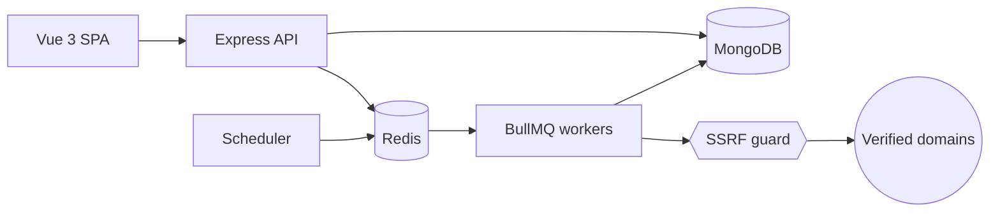

# SiteSentinel

**Passive security & health monitoring for websites you own: TLS, security headers, email DNS, uptime, graded A–F.**

[](https://github.com/lavitsamson/sitesentinel-security-monitor/actions/workflows/ci.yml)

> **Ethical use.** SiteSentinel only performs _passive_ checks (normal HTTPS requests, TLS handshakes and public DNS lookups, exactly what a browser or mail server does) and only against domains whose ownership you have verified. It does **no** port scanning, crawling, fuzzing, vulnerability probing or brute forcing.

> 🚧 Work in progress: milestones 1 (foundation), 2 (auth, sites, domain verification), 3 (checks package and scoring) and 4 (workers, scheduling, incidents) are complete. See [docs/PROGRESS.md](docs/PROGRESS.md).

## Live demo

_Coming in milestone 10._ Demo login: `demo@sitesentinel.demo` / `DemoPass123!`.

Locally, `pnpm seed` creates the same account with twelve well-known public sites and 30 days of generated run history. They are **demo data only**: labelled as such (every generated finding starts with "Demo data"), pre-verified without proof, checked passively once a day, and excluded from check-now. Real sites must prove ownership first.

## Features

Planned scope (tracked in [PROGRESS.md](docs/PROGRESS.md)):

- Six passive checks: **TLS**, **security headers**, **HTTPS redirect**, **email DNS** (MX/SPF/DMARC), **security.txt**, **uptime**
- Weighted score and A–F grade per site, with a plain-English recommendation for every finding
- Domain ownership verification (DNS TXT or well-known file)
- Scheduled checks on BullMQ workers, incidents on state change, email and HMAC-signed webhook alerts
- SSRF-hardened outbound requests (private ranges blocked, DNS-rebinding safe, every redirect re-validated)
- Dashboard, trend charts, PDF reports, Prometheus metrics

## Architecture



More detail in [docs/ARCHITECTURE.md](docs/ARCHITECTURE.md).

## Tech stack

| Area     | Choice                                                                        |
| -------- | ----------------------------------------------------------------------------- |
| Frontend | Vue 3 (`<script setup>`), Vite, Vue Router, Pinia, Vuetify 3                  |
| API      | Node.js 24, Express 5, zod, pino, helmet, OpenAPI 3.1 (zod-to-openapi)        |
| Workers  | BullMQ on Redis, as a separate process                                        |
| Data     | MongoDB + Mongoose, Redis                                                     |
| Testing  | Jest + Supertest + mongodb-memory-server, Vitest + Vue Test Utils, Playwright |
| Tooling  | pnpm workspaces, TypeScript strict, ESLint, Prettier, Husky, commitlint       |
| CI       | GitHub Actions                                                                |

## Local setup

Prerequisites: Node.js 24+, pnpm 12 (`corepack enable`), Docker.

```bash
pnpm install
cp .env.example .env
docker compose up -d        # MongoDB, Redis, Mailpit
pnpm seed                   # demo account + demo sites
pnpm dev                    # web :5173, api :4000, worker
```

Then open:

- Web app: http://localhost:5173
- API docs (Swagger UI): http://localhost:4000/api/docs
- Readiness: http://localhost:4000/api/v1/health/ready
- Sign in: `demo@sitesentinel.demo` / `DemoPass123!`, or register (password-reset emails land in Mailpit)
- Mailpit (captured email): http://localhost:8025

## Commands

| Command          | What it does                                                                                       |
| ---------------- | -------------------------------------------------------------------------------------------------- |
| `pnpm dev`       | Run web, api and worker with hot reload                                                            |
| `pnpm lint`      | ESLint across the repo                                                                             |
| `pnpm format`    | Prettier write (`format:check` in CI)                                                              |
| `pnpm typecheck` | Type-check every package                                                                           |
| `pnpm test`      | Unit tests (Jest for Node packages, Vitest for web)                                                |
| `pnpm test:int`  | Integration tests (in-memory MongoDB, downloaded on first run; BullMQ tests need `TEST_REDIS_URL`) |
| `pnpm test:e2e`  | Playwright end-to-end tests (milestone 8)                                                          |
| `pnpm build`     | Production build of every package                                                                  |
| `pnpm seed`      | Recreate the demo account, its labelled demo sites and history                                     |

## Testing

Tests never make real network calls: HTTP is stubbed with `nock`, DNS and TLS are injected into checks (the TLS client itself is tested against a local TLS server on loopback), and integration tests use an in-memory MongoDB. The worker's BullMQ tests (job-id dedupe, busy-domain delay, graceful shutdown, the lock script) need a real Redis: CI provides one, and locally they run with `docker compose up -d redis` and `TEST_REDIS_URL=redis://localhost:6379 pnpm test:int` (they are skipped without it). CI runs lint → format → typecheck → unit → integration → build on every push and pull request.

## Design decisions

- [ADR 0001: Monorepo with a framework-free checks package](docs/adr/0001-monorepo-and-package-boundaries.md). Checks are pure functions with injected HTTP/DNS/TLS/clock, so they're exhaustively testable offline, and the API and workers are separate processes.
- [ADR 0002: One SSRF guard for every outbound request](docs/adr/0002-ssrf-protection.md). Every hop is re-validated, every resolved address must be public, and the socket is pinned to the checked IP, so DNS rebinding and redirect-to-metadata tricks fail.
- [ADR 0003: Mongoose models in a shared `packages/db`](docs/adr/0003-shared-db-package.md). The API and the worker share one definition of each collection, its indexes and TTLs, and one mongoose instance.
- [ADR 0004: Scheduling with deterministic job ids](docs/adr/0004-scheduling-and-job-ids.md). A once-a-minute cluster-wide tick, job ids derived from `lastCheckedAt`, so duplicate checks are impossible, plus a per-domain lock so a site never sees two checks at once.

## Security

See [docs/SECURITY.md](docs/SECURITY.md).

## How I used AI

See [docs/AI_USAGE.md](docs/AI_USAGE.md).

## Author

**Lavit Samson**, Senior Full-Stack Engineer · [linkedin.com/in/lavit-samson](https://linkedin.com/in/lavit-samson)
