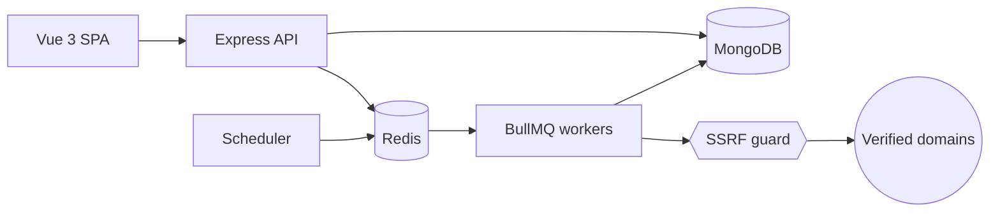

# SiteSentinel

**Passive security & health monitoring for websites you own: TLS, security headers, email DNS, uptime, graded A–F.**

[](https://github.com/lavitsamson/sitesentinel-security-monitor/actions/workflows/ci.yml)

> **Ethical use.** SiteSentinel only performs _passive_ checks (normal HTTPS requests, TLS handshakes and public DNS lookups, exactly what a browser or mail server does) and only against domains whose ownership you have verified. It does **no** port scanning, crawling, fuzzing, vulnerability probing or brute forcing.

> 🚧 Work in progress: milestones 1 (foundation), 2 (auth, sites, domain verification), 3 (checks package and scoring), 4 (workers, scheduling, incidents), 5 (web dashboard), 6 (alerts) and 7 (reports and metrics) are complete. See [docs/PROGRESS.md](docs/PROGRESS.md).

## Live demo

_Coming in milestone 10._ Demo login: `demo@sitesentinel.demo` / `DemoPass123!`.

Locally, `pnpm seed` creates the same account with twelve well-known public sites and 30 days of generated run history. They are **demo data only**: labelled as such (every generated finding starts with "Demo data"), pre-verified without proof, checked passively once a day, and excluded from check-now. Real sites must prove ownership first.

## Features

Planned scope (tracked in [PROGRESS.md](docs/PROGRESS.md)):

- Six passive checks: **TLS**, **security headers**, **HTTPS redirect**, **email DNS** (MX/SPF/DMARC), **security.txt**, **uptime**
- Weighted score and A–F grade per site, with a plain-English recommendation for every finding
- Domain ownership verification (DNS TXT or well-known file)
- Scheduled checks on BullMQ workers, incidents on state change, email and HMAC-signed webhook alerts
- SSRF-hardened outbound requests (private ranges blocked, DNS-rebinding safe, every redirect re-validated)
- Dashboard (grade distribution, sites needing attention, open incidents, recent changes)
- Sites table with server-side cursor pagination, filters, sorting and bulk actions
- Add-site wizard: enter a domain, pick a verification method, copy the token, verify
- Site detail: per-check findings with recommendations, 30-day score trend, response times, run history
- Alert channels (email, HMAC-signed Slack-compatible webhooks) with test sends and per-channel delivery status; alerts only on incident open/resolve
- Settings: name, email alert mute, password change (signs out other devices)
- One-page PDF report per site: grade, per-check results, 30-day trend, open incidents, findings with recommendations
- Prometheus metrics from the API (HTTP traffic, queue depth) and the worker (jobs processed, durations, retries and failures, check results), and Bull Board for operators

## Architecture



More detail in [docs/ARCHITECTURE.md](docs/ARCHITECTURE.md).

## Tech stack

| Area     | Choice                                                                        |
| -------- | ----------------------------------------------------------------------------- |
| Frontend | Vue 3 (`<script setup>`), Vite, Vue Router, Pinia, Vuetify 3, vue-chartjs     |
| API      | Node.js 24, Express 5, zod, pino, helmet, OpenAPI 3.1 (zod-to-openapi)        |
| Workers  | BullMQ on Redis, as a separate process                                        |
| Data     | MongoDB + Mongoose, Redis                                                     |
| Testing  | Jest + Supertest + mongodb-memory-server, Vitest + Vue Test Utils, Playwright |
| Tooling  | pnpm workspaces, TypeScript strict, ESLint, Prettier, Husky, commitlint       |
| CI       | GitHub Actions                                                                |

## Local setup

Prerequisites: Node.js 24+, pnpm 12 (`corepack enable`), Docker.

```bash
pnpm install
cp .env.example .env
docker compose up -d        # MongoDB, Redis, Mailpit
pnpm seed                   # demo account + demo sites
pnpm dev                    # web :5173, api :4000, worker
```

Then open:

- Web app: http://localhost:5173
- API docs (Swagger UI): http://localhost:4000/api/docs
- Readiness: http://localhost:4000/api/v1/health/ready
- Sign in: `demo@sitesentinel.demo` / `DemoPass123!`, or register (password-reset emails land in Mailpit)
- Mailpit (captured email): http://localhost:8025
- Metrics: http://localhost:4000/api/v1/metrics (API) and http://localhost:9464/metrics (worker)
- Queue dashboard (Bull Board): http://localhost:4000/admin/queues, user `admin`, password `BULL_BOARD_PASSWORD` from `.env` (the board is off until one is set)

## Commands

| Command          | What it does                                                                                       |
| ---------------- | -------------------------------------------------------------------------------------------------- |
| `pnpm dev`       | Run web, api and worker with hot reload                                                            |
| `pnpm lint`      | ESLint across the repo                                                                             |
| `pnpm format`    | Prettier write (`format:check` in CI)                                                              |
| `pnpm typecheck` | Type-check every package                                                                           |
| `pnpm test`      | Unit tests (Jest for Node packages, Vitest for web)                                                |
| `pnpm test:int`  | Integration tests (in-memory MongoDB, downloaded on first run; BullMQ tests need `TEST_REDIS_URL`) |
| `pnpm test:e2e`  | Playwright end-to-end tests (milestone 8)                                                          |
| `pnpm build`     | Production build of every package                                                                  |
| `pnpm seed`      | Recreate the demo account, its labelled demo sites, history and alert channel                      |

## Webhook alerts

Each webhook channel gets a signing secret (`whsec_…`), shown once when the channel is created. Alerts are `POST`ed as JSON with a Slack-compatible `text` field, so a Slack incoming-webhook URL works as-is:

```json
{
  "event": "incident.opened",
  "text": "[SiteSentinel] …",
  "sentAt": "2026-10-22T09:00:00.000Z",
  "incident": {
    "id": "…",
    "type": "TLS",
    "summary": "…",
    "openedAt": "…",
    "resolvedAt": null,
    "url": "…"
  },
  "site": { "id": "…", "domain": "example.com", "displayName": "Example" }
}
```

Every request carries `X-SiteSentinel-Signature: t=<unix seconds>,v1=<hex HMAC-SHA256>` computed over `"<t>.<raw body>"`, plus `X-SiteSentinel-Event` and `X-SiteSentinel-Delivery` (stable across retries, for de-duplication). To verify, in Node.js:

```ts
import { createHmac, timingSafeEqual } from 'node:crypto';

function isFromSiteSentinel(secret: string, rawBody: string, header: string): boolean {
  const parts = Object.fromEntries(header.split(',').map((p) => p.split('=') as [string, string]));
  const t = Number(parts.t);
  if (!Number.isInteger(t) || Math.abs(Date.now() / 1000 - t) > 300) return false; // replay
  const expected = createHmac('sha256', secret).update(`${t}.${rawBody}`).digest();
  const given = Buffer.from(parts.v1 ?? '', 'hex');
  return given.length === expected.length && timingSafeEqual(given, expected);
}
```

Verify against the raw request body, before any JSON parsing. Webhook URLs must be `https://` on the default port and resolve to a public address; redirects are not followed. Design: [ADR 0005](docs/adr/0005-alert-delivery.md).

## Operations

**Metrics.** Both processes serve Prometheus metrics, each measuring what it can see directly ([ADR 0006](docs/adr/0006-metrics-and-queue-dashboard.md)):

| Metric                                       | From   | Labels                                                |
| -------------------------------------------- | ------ | ----------------------------------------------------- |
| `sitesentinel_http_requests_total`           | API    | `method`, `route` (template), `status`                |
| `sitesentinel_http_request_duration_seconds` | API    | `method`, `route`                                     |
| `sitesentinel_queue_jobs`                    | API    | `queue`, `state` (read from Redis at scrape time)     |
| `sitesentinel_jobs_processed_total`          | Worker | `queue`, `outcome`: completed, retry, failed, delayed |
| `sitesentinel_job_duration_seconds`          | Worker | `queue`, `outcome`                                    |
| `sitesentinel_check_runs_total`              | Worker | `type`, `status` (PASS, WARN, FAIL, ERROR)            |
| `process_*`, `nodejs_*`                      | Both   | Node.js defaults                                      |

Set `METRICS_TOKEN` to require `Authorization: Bearer <token>` on both. The worker's port is `WORKER_METRICS_PORT` (default 9464, `0` turns it off); it also answers `GET /health/live`.

**Bull Board** is mounted at `/admin/queues` on the API when `BULL_BOARD_PASSWORD` (16+ characters) is set, and never in production unless `BULL_BOARD_ENABLED=true`. It uses HTTP Basic auth (`BULL_BOARD_USERNAME`, default `admin`), rate-limits wrong passwords, and refuses cross-site state-changing requests.

## Testing

Tests never make real network calls: HTTP is stubbed with `nock`, DNS and TLS are injected into checks (the TLS client itself is tested against a local TLS server on loopback), and integration tests use an in-memory MongoDB. The worker's BullMQ tests (job-id dedupe, busy-domain delay, graceful shutdown, the lock script) need a real Redis: CI provides one, and locally they run with `docker compose up -d redis` and `TEST_REDIS_URL=redis://localhost:6379 pnpm test:int` (they are skipped without it). CI runs lint → format → typecheck → unit → integration → build on every push and pull request.

## Design decisions

- [ADR 0001: Monorepo with a framework-free checks package](docs/adr/0001-monorepo-and-package-boundaries.md). Checks are pure functions with injected HTTP/DNS/TLS/clock, so they're exhaustively testable offline, and the API and workers are separate processes.
- [ADR 0002: One SSRF guard for every outbound request](docs/adr/0002-ssrf-protection.md). Every hop is re-validated, every resolved address must be public, and the socket is pinned to the checked IP, so DNS rebinding and redirect-to-metadata tricks fail.
- [ADR 0003: Mongoose models in a shared `packages/db`](docs/adr/0003-shared-db-package.md). The API and the worker share one definition of each collection, its indexes and TTLs, and one mongoose instance.
- [ADR 0004: Scheduling with deterministic job ids](docs/adr/0004-scheduling-and-job-ids.md). A once-a-minute cluster-wide tick, job ids derived from `lastCheckedAt`, so duplicate checks are impossible, plus a per-domain lock so a site never sees two checks at once.
- [ADR 0005: Alert delivery](docs/adr/0005-alert-delivery.md). One job per incident transition and one delivery record per channel, so retries reach only the channels that failed and nobody is alerted twice; webhooks are HMAC-signed with secrets encrypted at rest.
- [ADR 0006: Metrics per process, and an operator-only queue dashboard](docs/adr/0006-metrics-and-queue-dashboard.md). Job metrics come from the worker that runs the jobs, queue depth from Redis via the API (so it isn't counted once per replica); Bull Board sits behind operator credentials and is off in production by default.

## Security

See [docs/SECURITY.md](docs/SECURITY.md).

## How I used AI

See [docs/AI_USAGE.md](docs/AI_USAGE.md).

## Author

**Lavit Samson**, Senior Full-Stack Engineer · [linkedin.com/in/lavit-samson](https://linkedin.com/in/lavit-samson)
