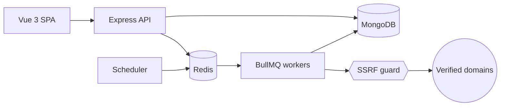

# SiteSentinel

**Passive security & health monitoring for websites you own: TLS, security headers, email DNS, uptime, graded A–F.**

[](https://github.com/lavitsamson/sitesentinel-security-monitor/actions/workflows/ci.yml)

> **Ethical use.** SiteSentinel only performs _passive_ checks (normal HTTPS requests, TLS handshakes and public DNS lookups, exactly what a browser or mail server does) and only against domains whose ownership you have verified. It does **no** port scanning, crawling, fuzzing, vulnerability probing or brute forcing.

> 🚧 Work in progress: milestone 1 (foundation) is complete. See [docs/PROGRESS.md](docs/PROGRESS.md).

## Live demo

_Coming in milestone 10._ Demo login: `demo@sitesentinel.demo` / `DemoPass123!` (seeded data, clearly labelled).

## Features

Planned scope (tracked in [PROGRESS.md](docs/PROGRESS.md)):

- Six passive checks: **TLS**, **security headers**, **HTTPS redirect**, **email DNS** (MX/SPF/DMARC), **security.txt**, **uptime**
- Weighted score and A–F grade per site, with a plain-English recommendation for every finding
- Domain ownership verification (DNS TXT or well-known file)
- Scheduled checks on BullMQ workers, incidents on state change, email and HMAC-signed webhook alerts
- SSRF-hardened outbound requests (private ranges blocked, DNS-rebinding safe, every redirect re-validated)
- Dashboard, trend charts, PDF reports, Prometheus metrics

## Architecture



More detail in [docs/ARCHITECTURE.md](docs/ARCHITECTURE.md).

## Tech stack

| Area     | Choice                                                                        |
| -------- | ----------------------------------------------------------------------------- |
| Frontend | Vue 3 (`<script setup>`), Vite, Vue Router, Pinia, Vuetify 3                  |
| API      | Node.js 24, Express 5, zod, pino, helmet, OpenAPI 3.1 (zod-to-openapi)        |
| Workers  | BullMQ on Redis, as a separate process                                        |
| Data     | MongoDB + Mongoose, Redis                                                     |
| Testing  | Jest + Supertest + mongodb-memory-server, Vitest + Vue Test Utils, Playwright |
| Tooling  | pnpm workspaces, TypeScript strict, ESLint, Prettier, Husky, commitlint       |
| CI       | GitHub Actions                                                                |

## Local setup

Prerequisites: Node.js 24+, pnpm 12 (`corepack enable`), Docker.

```bash
pnpm install
cp .env.example .env
docker compose up -d        # MongoDB, Redis, Mailpit
pnpm dev                    # web :5173, api :4000, worker
```

Then open:

- Web app: http://localhost:5173
- API docs (Swagger UI): http://localhost:4000/api/docs
- Readiness: http://localhost:4000/api/v1/health/ready
- Mailpit (captured email): http://localhost:8025

## Commands

| Command          | What it does                                                   |
| ---------------- | -------------------------------------------------------------- |
| `pnpm dev`       | Run web, api and worker with hot reload                        |
| `pnpm lint`      | ESLint across the repo                                         |
| `pnpm format`    | Prettier write (`format:check` in CI)                          |
| `pnpm typecheck` | Type-check every package                                       |
| `pnpm test`      | Unit tests (Jest for Node packages, Vitest for web)            |
| `pnpm test:int`  | Integration tests (in-memory MongoDB, downloaded on first run) |
| `pnpm test:e2e`  | Playwright end-to-end tests (milestone 8)                      |
| `pnpm build`     | Production build of every package                              |
| `pnpm seed`      | Demo data (milestone 2+)                                       |

## Testing

Tests never make real network calls: HTTP is stubbed with `nock`, DNS and TLS are injected into checks, and integration tests use an in-memory MongoDB. CI runs lint → format → typecheck → unit → integration → build on every push and pull request.

## Design decisions

- [ADR 0001: Monorepo with a framework-free checks package](docs/adr/0001-monorepo-and-package-boundaries.md). Checks are pure functions with injected HTTP/DNS/TLS/clock, so they're exhaustively testable offline, and the API and workers are separate processes.

## Security

See [docs/SECURITY.md](docs/SECURITY.md).

## How I used AI

See [docs/AI_USAGE.md](docs/AI_USAGE.md).

## Author

**Lavit Samson**, Senior Full-Stack Engineer · [linkedin.com/in/lavit-samson](https://linkedin.com/in/lavit-samson)
