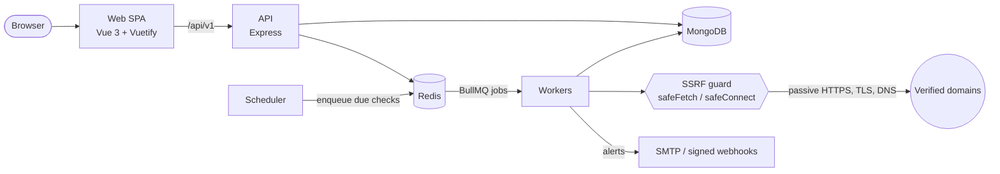

# Architecture

## Overview

Components marked as future work (scheduler, SSRF guard, alerts) are built in milestones 3–6. See [PROGRESS.md](PROGRESS.md).

## Packages

| Package           | Responsibility                                                                                  |
| ----------------- | ----------------------------------------------------------------------------------------------- |
| `apps/web`        | Vue 3 SPA. Talks only to the API, same-origin via the Vite proxy in development.                |
| `apps/api`        | REST API. Auth, ownership checks, validation, OpenAPI. Never makes outbound check requests.     |
| `apps/worker`     | BullMQ consumers + scheduler. Runs checks, stores runs, opens/resolves incidents, sends alerts. |
| `packages/shared` | zod schemas, enums and types shared by all apps. `./node` subpath for server-only helpers.      |
| `packages/checks` | Pure check functions with injected dependencies. No framework or database code.                 |
| `packages/config` | Shared tsconfig, ESLint, Prettier and Jest presets.                                             |

Why it's split this way: [ADR 0001](adr/0001-monorepo-and-package-boundaries.md).

## Cross-cutting conventions

- **Validation:** every input is parsed with a zod schema from `packages/shared`; the same schemas generate the OpenAPI 3.1 document served at `/api/docs`.
- **Errors:** RFC 9457 Problem Details (`application/problem+json`). Unexpected errors return a generic 500 and are logged with the request id.
- **Logging:** pino JSON logs; each request gets an `x-request-id` (a safe caller-supplied value is honoured). Credentials, cookies and secrets are redacted.
- **Health:** `/api/v1/health/live` checks only the process (no dependencies, so a database outage never restarts healthy pods). `/api/v1/health/ready` probes MongoDB and Redis in parallel with a per-probe timeout and returns 503 naming the failing dependency.
- **Shutdown:** on SIGTERM each process stops accepting work, finishes in-flight work, closes connections in order, and force-exits after a deadline.
- **Configuration:** environment variables only, validated at startup (all problems reported at once). Documented in [`.env.example`](../.env.example).
