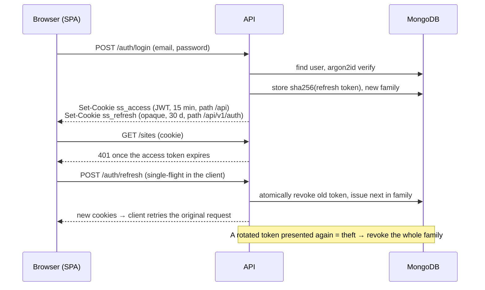
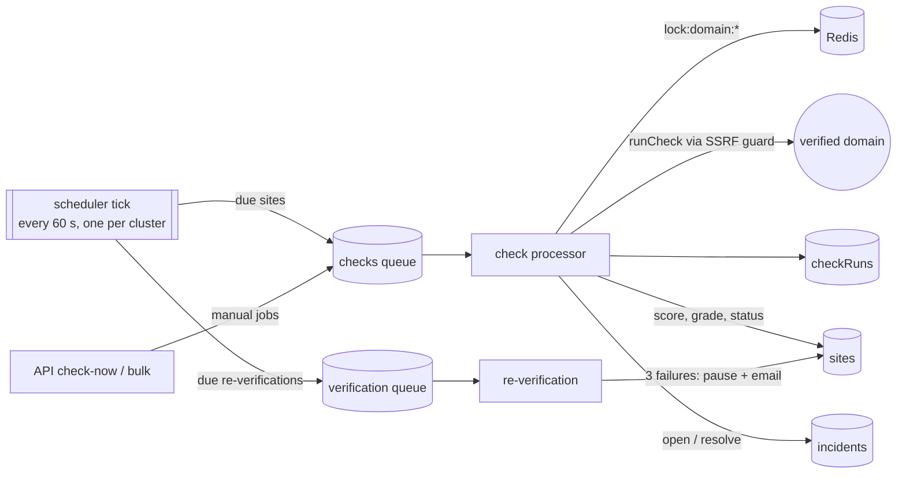

# Architecture

## Overview

The scheduler, workers, run storage and incidents exist from milestone 4; alert delivery arrives in milestone 6. See [PROGRESS.md](PROGRESS.md).

## Packages

| Package           | Responsibility                                                                                                           |
| ----------------- | ------------------------------------------------------------------------------------------------------------------------ |
| `apps/web`        | Vue 3 SPA. Talks only to the API, same-origin via the Vite proxy in development.                                         |
| `apps/api`        | REST API. Auth, ownership checks, validation, OpenAPI. Outbound traffic: ownership proofs only. Enqueues check-now jobs. |
| `apps/worker`     | BullMQ consumers + scheduler. Runs checks, stores runs, opens/resolves incidents, sends alerts.                          |
| `packages/shared` | zod schemas, enums and types shared by all apps. `./node` subpath for server-only helpers.                               |
| `packages/db`     | Mongoose models, indexes and DTO mappers shared by the API and the worker ([ADR 0003](adr/0003-shared-db-package.md)).   |
| `packages/checks` | Pure checks, ownership verification and the SSRF-guarded HTTP client. No framework or DB code.                           |
| `packages/config` | Shared tsconfig, ESLint, Prettier and Jest presets.                                                                      |

Why it's split this way: [ADR 0001](adr/0001-monorepo-and-package-boundaries.md).

## Cross-cutting conventions

- **Validation:** every input is parsed with a zod schema from `packages/shared`; the same schemas generate the OpenAPI 3.1 document served at `/api/docs`.
- **Errors:** RFC 9457 Problem Details (`application/problem+json`). Unexpected errors return a generic 500 and are logged with the request id.
- **Logging:** pino JSON logs; each request gets an `x-request-id` (a safe caller-supplied value is honoured). Credentials, cookies and secrets are redacted.
- **Health:** `/api/v1/health/live` checks only the process (no dependencies, so a database outage never restarts healthy pods). `/api/v1/health/ready` probes MongoDB and Redis in parallel with a per-probe timeout and returns 503 naming the failing dependency.
- **Shutdown:** on SIGTERM each process stops accepting work, finishes in-flight work, closes connections in order, and force-exits after a deadline.
- **Configuration:** environment variables only, validated at startup (all problems reported at once). Documented in [`.env.example`](../.env.example).

## Authentication

Both cookies are `httpOnly` and `SameSite=Strict`; mutating requests also need `X-Requested-With` (CSRF). Details: [SECURITY.md](SECURITY.md).

## Domain verification

Adding a site returns a random token. `POST /sites/:id/verify` proves ownership by either:

- a DNS TXT record `sitesentinel-verify=<token>` on the domain, or
- `https://<domain>/.well-known/sitesentinel-verify.txt` containing the token, fetched **without following redirects** so another host can't vouch for the domain.

The verifier lives in `packages/checks` with injected DNS and HTTP. The API calls it synchronously (the user is waiting), rate-limited per user, and its HTTP goes through the SSRF guard ([ADR 0002](adr/0002-ssrf-protection.md)). The worker re-verifies weekly (see below).

## Checks and scoring

Each check in `packages/checks/src/checks` is a function `(target, { http, dns, tls, clock }) => Promise<CheckResult>`. In production `http` is `safeFetch`, `tls` is `safeConnect` and `dns` is a resolver with a timeout. Tests swap in in-memory fakes, so the whole package runs offline with a 95% coverage gate.

| Check              | Request                                              | Fails when                                           |
| ------------------ | ---------------------------------------------------- | ---------------------------------------------------- |
| `TLS`              | Handshake on 443, SNI = domain                       | Expired, not yet valid, hostname mismatch, untrusted |
| `SECURITY_HEADERS` | `GET https://domain/` (≤ 3 redirects)                | Weighted header points below 50                      |
| `HTTPS_REDIRECT`   | `GET http://domain/`, redirects not followed         | Content served over plain HTTP                       |
| `EMAIL_DNS`        | MX, TXT (SPF, following `include:`), TXT at `_dmarc` | SPF `+all`, multiple SPF records, > 10 SPF lookups   |
| `SECURITY_TXT`     | `GET /.well-known/security.txt`                      | Never (missing is low severity)                      |
| `UPTIME`           | `HEAD https://domain/`, GET if HEAD returns an error | Unreachable or 5xx                                   |

Every number that turns findings into a grade lives in `packages/shared/src/scoring.ts`, so the worker, API and UI agree:

- **Status:** any `high` finding → FAIL, any `medium` → WARN, otherwise PASS. Security headers use their score instead (≥ 80 PASS, ≥ 50 WARN).
- **Check score:** `100 − penalties` (low 10, medium 25, high 50). Hard failures (expired certificate, plain HTTP, site down) score 0. Security headers earn weighted points per header (HSTS 25, CSP 25, frame protection 15, nosniff 10, Referrer-Policy 10, Permissions-Policy 10, no version leak 5).
- **Overall:** weighted average (TLS 30, headers 25, HTTPS redirect 15, email DNS 15, security.txt 5, uptime 10) of the latest result per check, graded A ≥ 90, B ≥ 80, C ≥ 70, D ≥ 60, else F. `ERROR` results (the checker could not run) are left out and the weights renormalised, so an outage on our side doesn't lower a site's grade.
- **Site status:** `siteStatusFromUptime` needs two failed uptime runs in a row for DOWN. A single failure or a response over 3 s is DEGRADED.

`runCheck` wraps every check so it never throws: a refused address, a resolver outage or a timeout becomes an `ERROR` run with an explanation.

## Workers and scheduling

- **Queues:** `checks` (one job per site per check type), `verification`, `scheduler` (the tick), and `alerts` (consumed from milestone 6). Names, job data schemas, ids and retry options live in `packages/shared/src/queues.ts`, so the API and the worker produce identical jobs.
- **Job ids are deterministic** (`<siteId>.<type>.<slot>`): a scheduled slot is the `lastCheckedAt` the job came from, and a manual slot is the 5-minute window. A tick that runs again, late or on another replica can't create a duplicate. Jitter is a per-site hash, up to 60 s. Details and alternatives: [ADR 0004](adr/0004-scheduling-and-job-ids.md).
- **Processing a check:** reload the site and skip it if it's deleted, unverified or paused (an unverified domain is never contacted, whatever is queued). Then take the per-domain Redis lock, run the check, and retry `ERROR` results with backoff, storing an ERROR run only on the last attempt. After storing the run (`raw` capped at 16 KB), recompute the site's score, grade and status (UPTIME only) with `$set`, then apply the incident rules.
- **Incidents:** open when a check moves to FAIL (UPTIME: when the site goes DOWN), stay open through WARN and further FAILs, and resolve on PASS. One open incident per site and check, enforced by a partial unique index.
- **Re-verification:** weekly, or daily after a failure. The third consecutive failure pauses the site, revokes its verification, writes an audit entry and emails the owner.
- **Graceful shutdown:** on SIGTERM the workers stop taking jobs and finish in-flight ones (`worker.close()`), then queues, MongoDB and Redis close.
- **Retention:** `checkRuns` has a 90-day TTL index on `startedAt`. Deleting a site deletes its runs and incidents; jobs still queued for it are dropped by the processor.

## Results API

- `GET /sites/:id/runs`: history, newest first, filter by `type`, `from`, `to`.
- `GET /sites/:id/runs/latest`: the newest run of each check.
- `GET /sites/:id/score-history?days=30`: one overall score per UTC day, computed with two aggregations (latest result per check before the window, and per day and check inside it) and carried forward day by day.
- `GET /incidents?open=&siteId=` and `GET /incidents/:id`. Each incident carries its site's domain and display name (one extra query per page), so lists don't need a lookup per row.
- `GET /sites/summary`: counts by grade and status from one `$facet` aggregation over the `(ownerId, currentGrade)` index, plus the five worst sites that are down, degraded or graded D/F. The dashboard makes one request instead of paging through every site.

All are owner-scoped: another user's site or incident is a 404.

## Web app

- **Data flow:** `src/api/*` wraps each endpoint and parses every response with the shared zod schema, so a contract drift fails loudly. Pinia stores (`auth`, `sites`, `incidents`) own list state; detail pages read through the API modules.
- **Cursor paging in a table:** the API only pages forward, so the sites store keeps the cursor that opened each visited page. "Previous" re-uses a remembered cursor; changing filters, sort or page size starts again at page one. A newer load aborts the one in flight, so a slow response never overwrites fresher results.
- **Errors:** `ApiError` keeps RFC 9457 extension members, which is how the wizard explains a failed verification method by method.
- **Charts:** Chart.js via vue-chartjs, registered per component (tree-shaken, lazy-loaded with the pages that use them). Colours come from the active Vuetify theme, and every chart has a text summary as its accessible name.
- **Accessibility:** grade and status colours are theme tokens checked at ≥ 4.5:1 in both themes, and every coloured chip also carries a text label.

## Pagination

Lists use keyset (cursor) pagination: `sort` field plus `_id` as a tie-breaker, with an index per sortable field that starts with `ownerId`. Cursors are opaque base64url, bound to their sort, and handle `null` values (unscored or never-checked sites) explicitly, so pages never skip or repeat rows.
